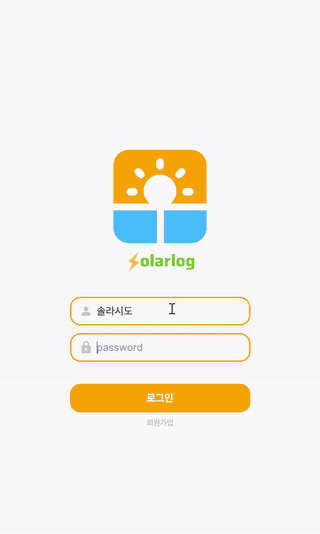
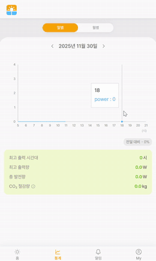
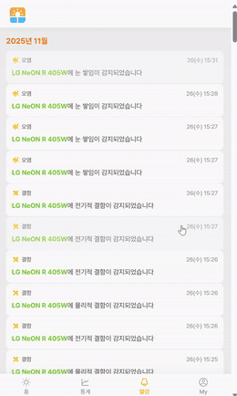
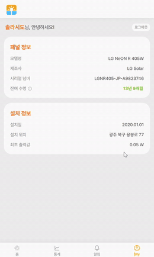
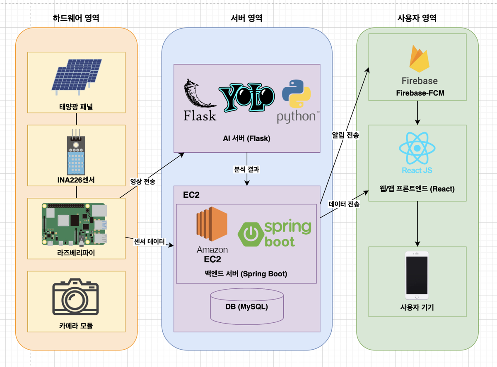

<div align="center">


# SolarLog

**태양광 패널 소유자가 전문 지식 없이도 발전량·오염·결함·잔여 수명을 한 화면에서 확인하고, 이상이 생기면 푸시 알림을 받는 패널 관리 웹앱(PWA)**

[🏆 한전KDN 빛가람 에너지밸리 SW 경진대회 대학부 최우수상](#-about) · [📂 원본 레포](https://github.com/Kepco-KDN-EnergyValley/SolarLog-FE)




</div>

## 📌 About
> 한전KDN 주최 **제11회 2025 빛가람 에너지밸리 소프트웨어 작품 경진대회** 대학부 · 5인 팀 "솔라시도"

- **문제**: 태양광 패널 소유자는 오염·결함이나 성능 저하를 직접 알아채기 어렵고, AI 분석 지표는 비전문가에게 어렵다.
- **해결**: 라즈베리파이·카메라로 발전량과 패널 사진을 수집하고, AI(YOLOv8 + CNN)가 오염·결함을 탐지하고 LSTM으로 잔여 수명을 예측한다. 웹앱은 이 결과를 쉬운 지표와 그래프로 보여주고, 탐지 즉시 푸시 알림을 보낸다.
- **성과**: 대학부 **최우수상** (2025.11.26), 실제 패널로 본선 현장 시연

## 🙋‍♀️ My Role
**UI/UX 디자인과 프론트엔드를 혼자 담당했습니다.** (FE 레포 커밋 91건 · Issue·PR 52건 전부 본인)

- **UI/UX 설계** — 서비스명·로고, Figma 와이어프레임·UI. AI 지표를 비전문가 기준으로 정리(성능 3단계 표시, 잔여 수명·CO₂ 절감량 공식 툴팁)
- **화면 9개 · API 15개 연동** — React + TypeScript, 공통 컴포넌트 20여 종, Recharts 발전량 그래프, date-fns로 일별·월별 캘린더 직접 구현
- **PWA + FCM 백그라운드 푸시** — vite-plugin-pwa `injectManifest`로 PWA·FCM 서비스워커를 하나로 통합, 알림 클릭 시 탐지 상세로 이동
- **인증·라우팅** — Redux Toolkit으로 JWT 저장·디코드, Axios 인터셉터로 헤더 첨부·401 처리, `PublicRoute`·`PrivateRoute` 라우트 가드
- **전역 에러·로딩 처리** — 401은 Axios 인터셉터, 404·500은 TanStack Query 전역 핸들러, 10초 이상 지연은 전역 로딩 훅
- **API 명세 협의** — BE 2인과 응답 구조를 `{ success, data }`로 통일, 노션 명세서에 "프론트 연동 여부" 컬럼 추가
- 주 역할 외 — 레포·Issue/PR 템플릿 세팅, Vercel 배포, 작품소개서 FE·웹 결과 작성, 본선 포스터 최종 편집

## ✨ Features
| 일별·월별 발전량 통계 | 오염·결함 탐지 알림 → 상세 | 패널 정보·잔여 수명 |
| :---: | :---: | :---: |
|  |  |  |
| 캘린더로 날짜·월을 골라 발전량 그래프, 최고 출력, CO₂ 절감량 확인 | 알림 목록에서 탐지 사진·유형·일시 확인 (탐지 모델은 팀원 구현) | 패널·설치 정보와 AI가 예측한 잔여 수명 확인 (예측 모델은 팀원 구현) |

## 🛠 Tech Stack
| 분류 | 기술 |
| :--- | :--- |
| **Design** (담당) |  |
| **Frontend** (담당) |          |
| **PWA · 알림** (담당) |    |
| **External API** |    |
| **Backend** (팀) |    |
| **AI · HW** (팀) |    |
| **Deploy · Tools** |    |

## 🏗 Architecture


> 하드웨어(라즈베리파이·센서·카메라) → AI 서버(오염·결함 탐지) · 백엔드(Spring Boot) → FCM · 웹 프론트엔드. 본인 담당은 **사용자 영역의 React 웹앱**입니다.

## 🔥 Troubleshooting
<details>
<summary><b>PWA에서 FCM 백그라운드 알림 구현 — data 메시지 전환 + 서비스워커 통합으로 커스텀 알림·클릭 이동 완성</b></summary>

- **문제**: 앱이 꺼져 있을 때 커스텀 알림 대신 브라우저 기본 알림이 따로 뜨고, 알림을 눌러도 탐지 상세로 이동하지 않았습니다. 같은 알림이 여러 번 오기도 했습니다.
- **원인**
  - 메시지에 `notification` 필드가 있으면 FCM SDK가 기본 알림을 자동으로 띄워 `onBackgroundMessage`의 커스텀 알림이 무시됨
  - FCM용 `firebase-messaging-sw.js`와 PWA 서비스워커가 따로 등록돼 같은 범위에서 충돌 (`not the client's active service worker` 에러)
  - 개발·빌드·배포 서버를 오가며 로그인할 때마다 FCM 토큰이 쌓여 한 사용자에게 유효 토큰 6개
- **해결**
  - 기본 알림을 쓰는 방법은 BE 수정이 적지만 클릭 시 상세로 보낼 `alarmId`를 담을 수 없어 **data-only 메시지**로 전환, payload(패널명·eventType·eventDetail·alarmId)를 직접 정의해 BE에 요청
  - vite-plugin-pwa `injectManifest`로 **Workbox 프리캐시 + FCM 처리를 서비스워커 하나로 통합**, `getToken()`에 통합 서비스워커 등록 객체 명시, `skipWaiting`·`clients.claim` 적용
  - `notificationclick`에서 `clients.matchAll()`로 열린 창을 찾아 `focus()` + `navigate()`, 없으면 `openWindow()`
  - 서비스워커는 Vite 개발 서버에서 제대로 동작하지 않아 `vite preview`(빌드 서버)로 테스트, BE와 협의해 사용자당 토큰 1개만 유지
- **결과**: 실시간 테스트 약 20회 끝에 **데스크톱 Chrome·Android Chrome(PWA)** 에서 포그라운드·백그라운드 알림, 커스텀 문구, 클릭 시 상세 이동까지 배포 환경에서 성공. 이전 캡스톤에서 실패했던 백그라운드 알림을 처음 완성했습니다.
</details>

<details>
<summary><b>알림·주소창으로 진입하면 홈으로 튕기는 문제 — 인증 초기화 완료 플래그를 분리해 요청한 화면 유지</b></summary>

- **문제**: 로그인 상태에서 푸시 알림을 눌러 `/detection/{id}`로 들어오거나 보호 경로를 주소창에 입력하면 요청한 화면 대신 `/home`으로 이동했습니다.
- **원인**
  - 레이아웃 아래 `index` 라우트가 `/` → `/home`으로 리다이렉트
  - 토큰 복구는 첫 렌더링 이후 `useEffect`에서 실행되는데 라우트 가드는 첫 렌더링에서 바로 판단 → **"토큰 없음"과 "아직 확인 안 함"이 같은 `null`**
- **해결**
  - 1차로 토큰 초기값을 `undefined`(미확인)로 두는 방식을 적용했으나, 토큰이 없을 때 상태를 바꾸지 않아 비로그인 사용자에게 흰 화면이 떠 revert
  - 한 필드에 "값"과 "확인 여부"를 함께 담으면 모든 경로를 빠짐없이 챙겨야 해서, **`initialized` 플래그를 따로 두고** 토큰이 있으면 `setToken`, 없으면 `finishInit` 디스패치
  - `initialized` 전에는 LoadingScreen을 보여주고 이후 토큰 유무로 분기, 루트 리다이렉트 제거
- **결과**: 새로고침·알림 클릭·직접 URL 입력 시 요청한 화면이 유지되고, 비로그인 사용자는 로그인 화면으로 정상 이동합니다. "값 없음"과 "아직 모름"은 다른 상태라는 것과, 인증 변경은 시나리오를 확인한 뒤 머지해야 한다는 것을 배웠습니다.
</details>

<details>
<summary><b>API 15개의 에러·로딩 처리 — Axios 인터셉터와 Query 전역 핸들러로 역할을 나눠 일원화</b></summary>

- **문제**: BE 서버를 테스트할 때만 켜는 상황이라 연결 실패·지연·토큰 만료가 잦았고, 화면마다 `try/catch`와 로딩 state를 두면 처리 방식이 제각각이 될 상황이었습니다.
- **원인**: 에러마다 생기는 위치와 필요한 처리가 달랐습니다. 401은 쿼리 밖 요청(로그인 등)에서도 생기고, 404·500은 페이지 이동이 필요하며, 지연은 무한 로딩으로 이어졌습니다.
- **해결**
  - 인터셉터 하나로 전부 처리하는 방법은 React 밖이라 라우터 이동·로딩 표시가 어려워 역할을 분리
  - **401** → Axios 응답 인터셉터(토큰 삭제 + 로그인 이동) / **404·500** → `QueryCache`·`MutationCache` `onError`에서 안내 화면 이동 / **로딩** → `useIsFetching`·`useIsMutating` 기반 `useGlobalLoading` 훅, 10초 이상 지속 시 NotFound
  - 로딩 화면이 헤더·하단 탭까지 가리지 않도록 `Layout` 콘텐츠 영역에만 표시
- **결과**: API 15개 중 11개는 화면에서 `useQuery`·`useMutation`만 호출하고 에러·로딩은 전역에서 같은 방식으로 처리됩니다.
</details>

<details>
<summary><b>📂 Folder Structure · 🚀 Getting Started</b></summary>

```
src
├─ apis        Axios 인스턴스·인터셉터, user · info · generation · detection · weather
├─ app         Redux store
├─ features    authSlice · authThunk
├─ routes      PublicRoute · PrivateRoute
├─ pages       Login · Signup · Home · Analysis · Notification · Detection · My · NotFound · Error
├─ components  common · home · analysis · mypage · notification · signup · login
├─ hooks       useGlobalLoading · useOutsideClick · useRedux
├─ utils       firebase · decodeToken · dateUtils ...
├─ types       API 응답·도메인 타입
└─ service-worker.js   Workbox 프리캐시 + FCM
```

```bash
npm install
npm run dev       # 개발 서버
npm run build && npm run preview   # 서비스워커·푸시 알림은 빌드 서버에서 테스트
```

`.env`에 아래 값이 필요합니다.

```
VITE_BASE_URL=
VITE_KAKAO_API_KEY=
VITE_WEATHER_API_KEY=
VITE_API_KEY=
VITE_AUTH_DOMAIN=
VITE_PROJECT_ID=
VITE_STORAGE_BUCKET=
VITE_MESSAGING_SENDER_ID=
VITE_APP_ID=
VITE_VAPID_KEY=
```

> ⚠️ 대회 종료 후 백엔드 서버(AWS EC2)를 종료해 현재는 로그인 이후 기능이 동작하지 않습니다. 동작 화면은 위 GIF를 참고해 주세요.
</details>
